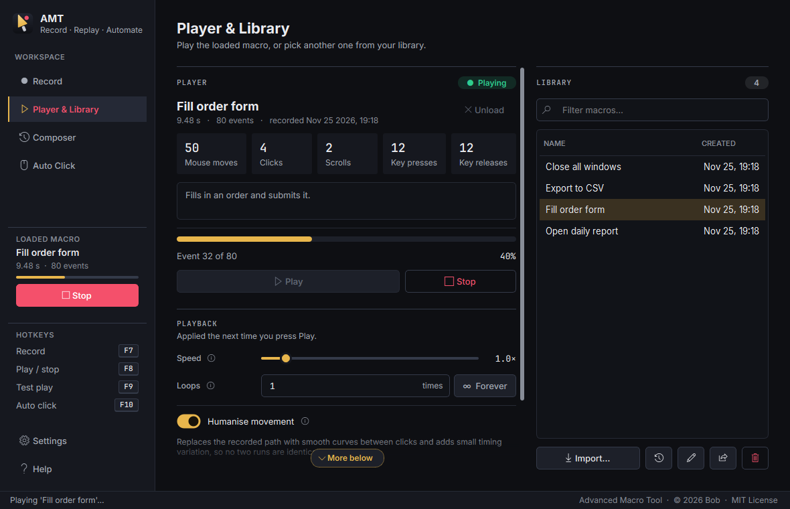
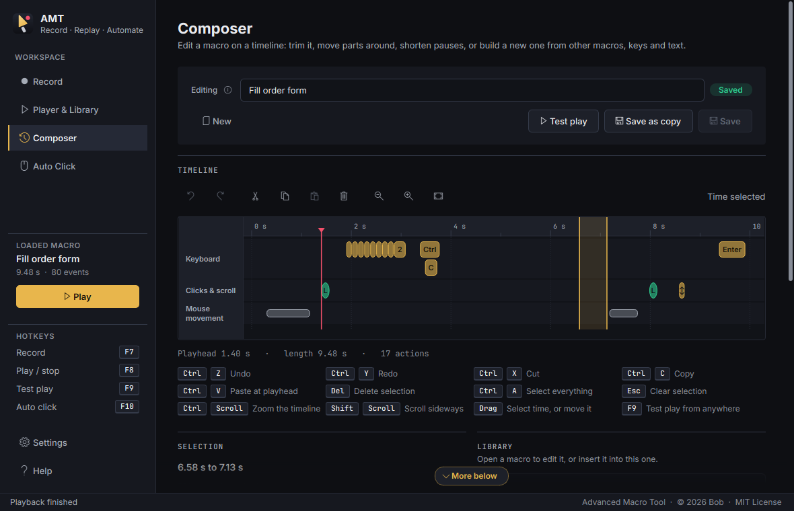

<p align="center"></p>

# AMT — Advanced Macro Tool

**Record · Replay · Automate.** A Windows desktop app for recording, saving and
replaying mouse and keyboard macros, with an auto clicker, a macro composer,
human-like path smoothing, and a clean, themeable interface that scales to any
window size.



## Download

**[Download AMT.exe from the latest release](https://github.com/Bobdevvv/AdvancedMacroTool/releases/latest)**,
then double-click it. Nothing to install, no Python needed; Windows 10 or 11.

Because AMT is free and not code-signed, Windows may say *"Windows protected
your PC"* the first time. Click **More info → Run anyway**. Every release is
built automatically from this source code by
[GitHub Actions](.github/workflows/release.yml), and comes with a SHA-256
checksum so you can check the file you downloaded.

Want to run it from the source code instead? See [Setup](#setup).

## Documentation

| If you want to… | Read |
|---|---|
| **Use AMT**: every page and feature explained in plain language, with ideas and tips | **[User guide](docs/GUIDE.md)**, also built into the app as **Help** |
| Just use it | [Download](#download) above |
| Run it from source | [Setup](#setup) below |
| Know what AMT does with your input and files | [Safety and privacy](#safety-and-privacy) below |
| Understand how it works inside: architecture, file format, guarantees | [Technical documentation](docs/TECHNICAL.md) |
| Change the code | [Contributing](CONTRIBUTING.md) |

> **AMT records every key you press while a recording is running, and saves
> it to a plain-text file.** That is what a macro recorder does, and it means a
> macro file can contain a password you typed by accident. It has no network
> access of any kind and sends nothing anywhere — but read
> [Safety and privacy](#safety-and-privacy) before your first recording.

---

## What AMT does

- **Record** your mouse and keyboard, including shortcuts like Ctrl+C and keys
  you hold down, and **play it back** exactly, as often as you like.
- **Edit** recordings on a timeline: cut out mistakes, move parts around,
  shorten pauses, or build a new macro from other macros, waits, shortcuts
  and text.
- **Auto click** at a steady rate, at the cursor or a fixed spot.
- **Humanise** playback so movement looks natural rather than robotic.
- Control it all with **global hotkeys** that work from any window.



For everything else, the [user guide](docs/GUIDE.md) explains each page step
by step; it is also built into the app as **Help**.

---

## Setup

Running from source, for developers. To just use AMT, [download the exe](#download).

### 1. Clone

```bash
git clone https://github.com/Bobdevvv/AdvancedMacroTool.git
cd AdvancedMacroTool
```

### 2. Create a virtual environment

Recommended, so PyQt6 and pynput do not land in your system Python.

```powershell
py -3.11 -m venv .venv
.\.venv\Scripts\Activate.ps1
```

<details>
<summary>Using cmd.exe, Git Bash, or the plain <code>python</code> launcher</summary>

```bat
:: cmd.exe
python -m venv .venv
.venv\Scripts\activate.bat
```

```bash
# Git Bash
python -m venv .venv
source .venv/Scripts/activate
```

If PowerShell refuses to run the activation script (`running scripts is disabled
on this system`), allow signed local scripts for your own account, once:

```powershell
Set-ExecutionPolicy -Scope CurrentUser RemoteSigned
```
</details>

### 3. Install dependencies

```bash
pip install -r requirements.txt
```

Three packages: `PyQt6` (GUI), `pynput` (global input capture and hotkeys), and
`pyinstaller` (only needed to build the `.exe`; harmless to have otherwise).

### 4. Run

```bash
python main.py
```

**Run it from the repository root.** `main.py` puts its own directory on
`sys.path` and then imports the `src.*` packages, so launching it from somewhere
else will fail with `ModuleNotFoundError: No module named 'src'`.

### 5. First run

On first launch the app creates its storage *outside* the repository:

```
C:\Users\<you>\Documents\AdvancedMacroTool\
├── macros\          <- one .json per recorded macro
├── logs\amt.log     <- error log (code locations only)
├── amt.lock         <- stops a second copy from starting
└── settings.json    <- hotkeys, theme, macro directory
```

Nothing is written into the cloned folder, and there is nothing to configure
before you start: press **F7**, do something, press **F7** again, and the
recording shows up on the Player & Library page. The [user guide](docs/GUIDE.md)
takes it from there.

Coming from a version before 1.0? Those used `Documents\MacroTool`. AMT
renames that folder to `Documents\AdvancedMacroTool` the first time it
starts, with all macros and settings inside, so nothing needs moving by hand.

---

## Troubleshooting

**`ModuleNotFoundError: No module named 'src'`**
You launched `main.py` from another directory. `cd` into the repository root
first.

**`ModuleNotFoundError: No module named 'PyQt6'`**
The virtual environment is not active, or you installed into a different
interpreter. Check with `python -c "import sys; print(sys.executable)"` — it
should point inside `.venv\Scripts\`.

**PyQt6 will not install / "no matching distribution"**
PyQt6 ships as wheels only for 64-bit CPython on supported versions, and a
brand-new Python release can be ahead of the available wheels. Install a
3.11–3.13 interpreter and build the venv against it: `py -3.11 -m venv .venv`.

**Global hotkeys do nothing**
- They are captured process-wide, so another application may already own that
  key. Rebind under **Settings → Bind**.
- Windows will not deliver input to a non-elevated process while an elevated
  window (Task Manager, an admin console, some anti-cheat-protected games) has
  focus. Run AMT as administrator if you need it to work over those.

**A recording produces a huge file**
Mouse movement is already throttled to ≥30 ms and ≥4 px between samples. For
click-driven tasks, turn on the Humaniser at playback — it discards the recorded
move path entirely and regenerates it between click checkpoints.

**Playback clicks land in the wrong place**
Macros store absolute screen coordinates. A different resolution, DPI scaling
factor, or monitor arrangement moves the targets. Re-record on the display you
intend to play back on.

**Keys stay held down after stopping**
They should not — the player tracks held keys and buttons and releases every one
of them on stop. If you do see it, tap the stuck modifier manually, and please
open an issue with the macro's event list (after reading
[Safety and privacy](#safety-and-privacy)).

---

## Default Hotkeys

| Action | Default |
|--------|---------|
| Toggle recording | F7 |
| Play / stop macro | F8 |
| Test play the Composer's edit | F9 |
| Toggle autoclicker | F10 |

The defaults follow the sidebar from top to bottom and stay within F7–F10,
away from the browser keys F5, F6, F11 and F12. All of them can be changed in
Settings.

Hotkeys work globally, even when the AMT window is not focused, and the
program in front does not also receive them: F7 no longer switches on caret
browsing in a browser, and F10 no longer opens a menu bar. Only the exact
bound combination is held back (with F7 bound, Ctrl+F7 still reaches the
program).

---

## Safety and privacy

AMT records global input. Read this once before you use it.

### What it does

While a recording is running, AMT installs a system-wide `pynput`
listener and writes **every key you press, verbatim**, to a JSON file — not
scancodes, not a hash, the literal character. That is what a macro recorder
is; it cannot work any other way. But it means a macro file is a keystroke
log, and it is worth knowing exactly when the log is being written:

- The listeners start when recording starts and are torn down when it stops.
  Nothing is captured between recordings.
- Hotkey listening (F7–F10) is always on while the app is open. That
  listener matches against the bound combinations only and does not record;
  the only keys it holds back from other programs are those combinations.

### What it does not do

- **No network access.** AMT has no HTTP client, no socket, no telemetry,
  no crash reporting, no update check. It imports `PyQt6` and `pynput` and
  nothing else. `grep -rn "requests\|urllib\|http\|socket" src/` comes back
  empty, and you should run it yourself.
- **No cloud storage or account.** Everything is local files.
- **No hidden collection.** The only files written are the macro `.json`s,
  `settings.json`, an error log and a lock file, all under
  `Documents\AdvancedMacroTool\` (macros go wherever you point the macro directory in
  Settings). The error log records only where an unexpected error happened in
  the code, never keys, macro contents or what you typed.

### Where your data lives

| What | Where |
|------|-------|
| Recorded macros | `C:\Users\<you>\Documents\AdvancedMacroTool\macros\` |
| Settings | `C:\Users\<you>\Documents\AdvancedMacroTool\settings.json` |
| Error log (code locations only, at most ~750 KB) | `C:\Users\<you>\Documents\AdvancedMacroTool\logs\amt.log` |
| Lock file (stops a second copy from starting) | `C:\Users\<you>\Documents\AdvancedMacroTool\amt.lock` |

Plain, unencrypted `.json`, readable by anything running as your user account.
Delete a macro from the library, or delete the file.

### Treat a macro file as a secret

If a password, card number, recovery phrase, 2FA code, or private message was
typed while you were recording, **it is sitting in that `.json` in plaintext**.

- Open a macro and read it before you share it, attach it to a bug report, or
  commit it anywhere.
- Stop recording before you switch to a password prompt. Recording keeps running
  across window and application switches — it does not know or care which app
  has focus.
- `.gitignore` in this repository excludes `macros/`, `*.macro.json` and
  `settings.json` on purpose, because the macro directory is user-configurable
  and can be pointed at a checkout. Don't relax those patterns to commit a
  "harmless" sample; hand-write the JSON instead, so nothing that touched a real
  keyboard is ever published.

### Do not play back a macro you did not record

Playback synthesises real keyboard and mouse input at OS level, with your
privileges. A macro file from someone else is, effectively, a script that types
for you — it can open a terminal, type a command, and press Enter. The format is
readable JSON: open it and check the `key` values before you run it.

### Rules and terms of service

Automating input can violate the terms of service of games, online platforms,
and workplace software, and can get an account banned. That is your call to
make, on systems you are entitled to use. This project is a general-purpose
automation tool and is offered without warranty — see [LICENSE](LICENSE).

---

## Contributing

Bug reports, fixes, and features are welcome — see [CONTRIBUTING.md](CONTRIBUTING.md)
for the dev setup, the test suite (`python -m unittest discover -s tests -t .`),
the definition of done, the architecture rules (core stays Qt-free; worker
threads talk to the UI only through `_Bridge` signals), and how to add a page or
a theme. Release checks that need a real desktop are in
[docs/QA-CHECKLIST.md](docs/QA-CHECKLIST.md).

Security reports and the tool's privacy boundaries: [SECURITY.md](SECURITY.md).

---

## License

**Advanced Macro Tool · © 2026 Bob.** Released under the MIT License; see
[LICENSE](LICENSE). Provided without warranty; automating input may violate the
terms of service of games, platforms, or workplace software, and that is your
call to make on systems you are entitled to use.
