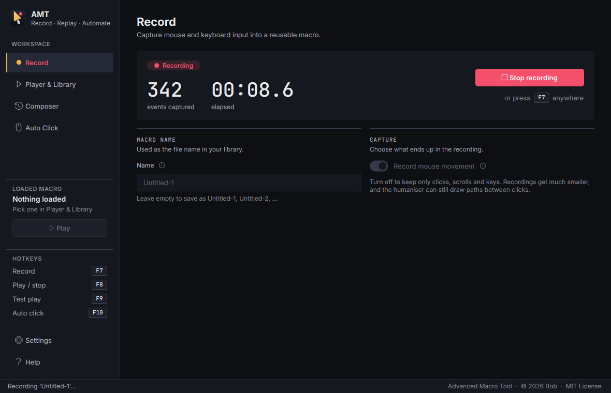
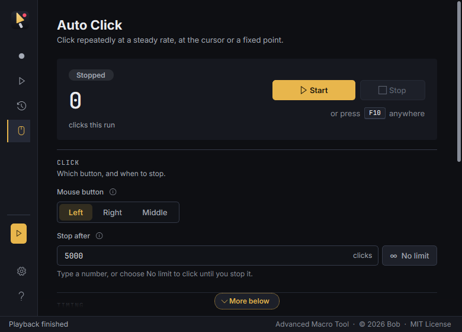
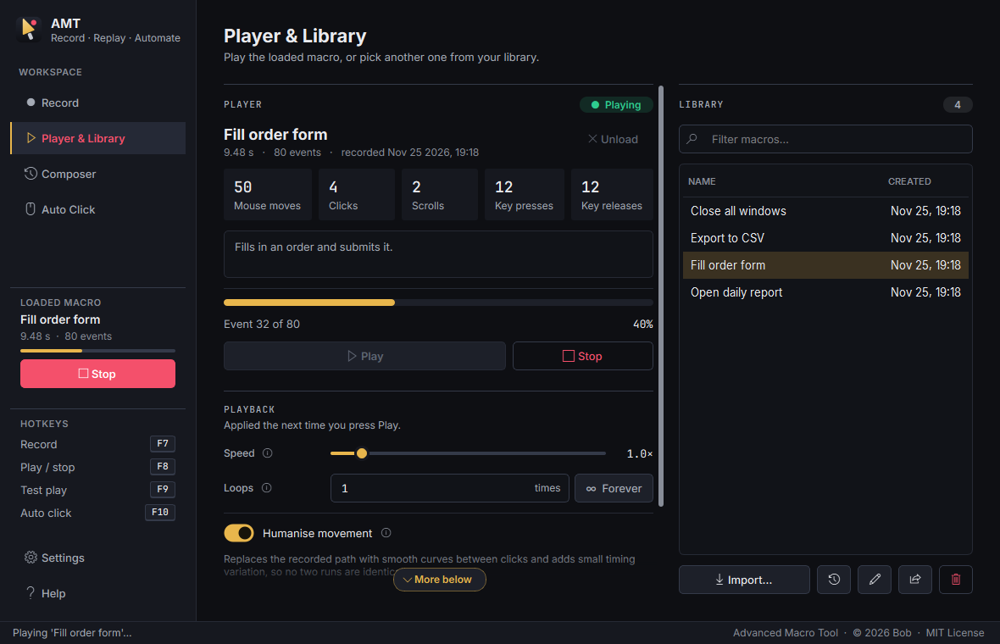
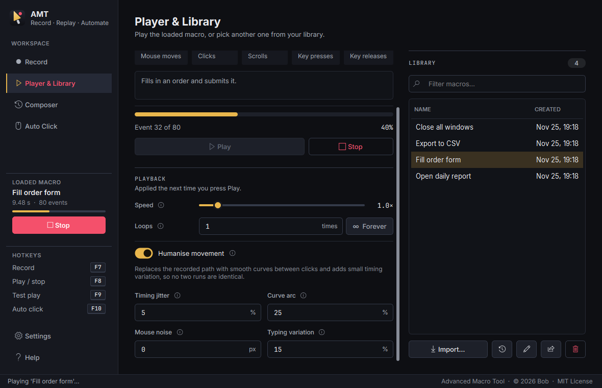
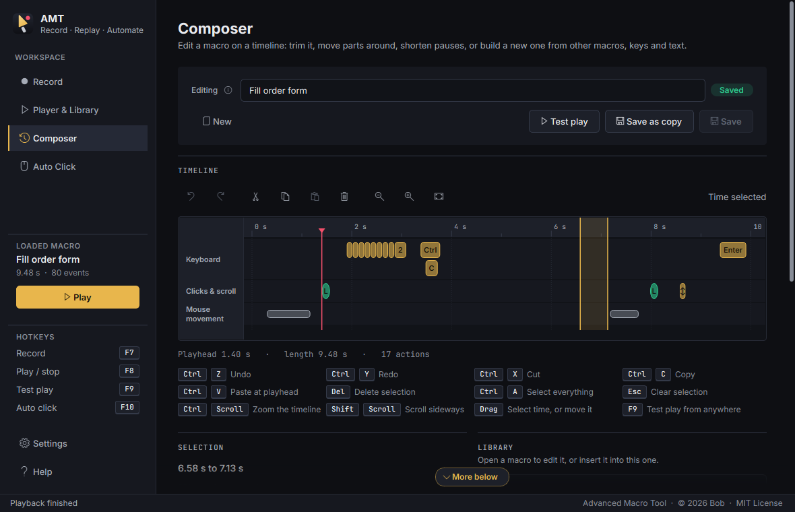
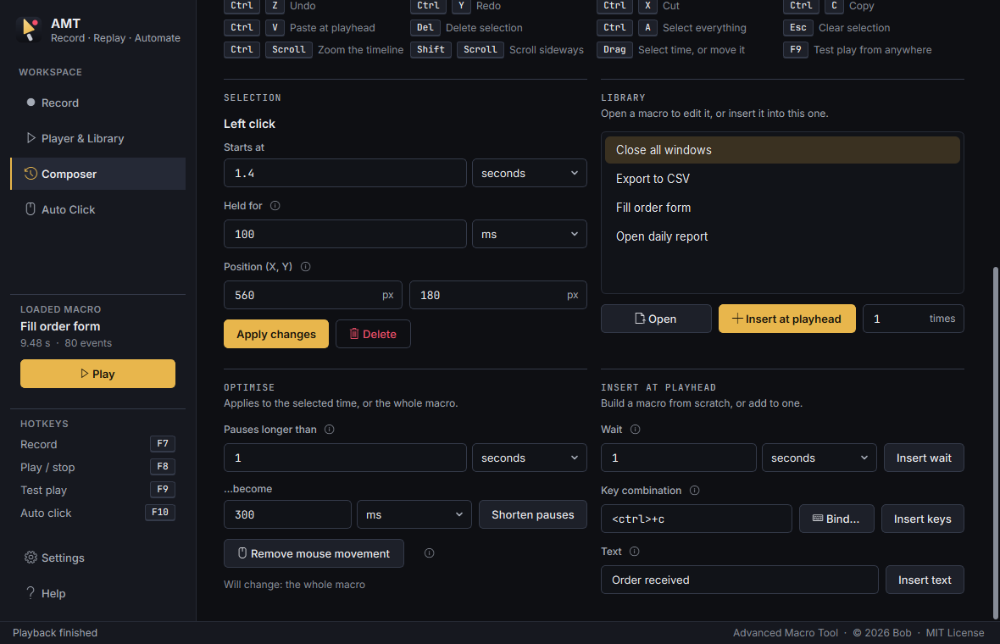
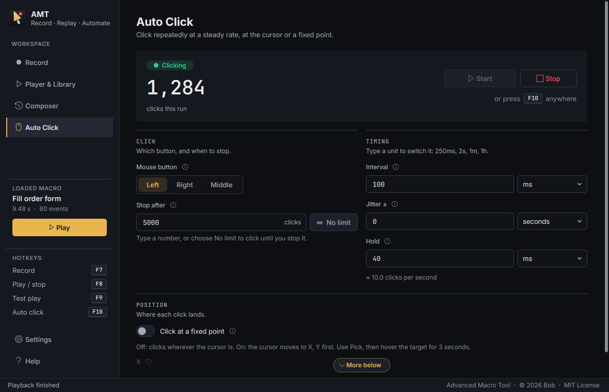
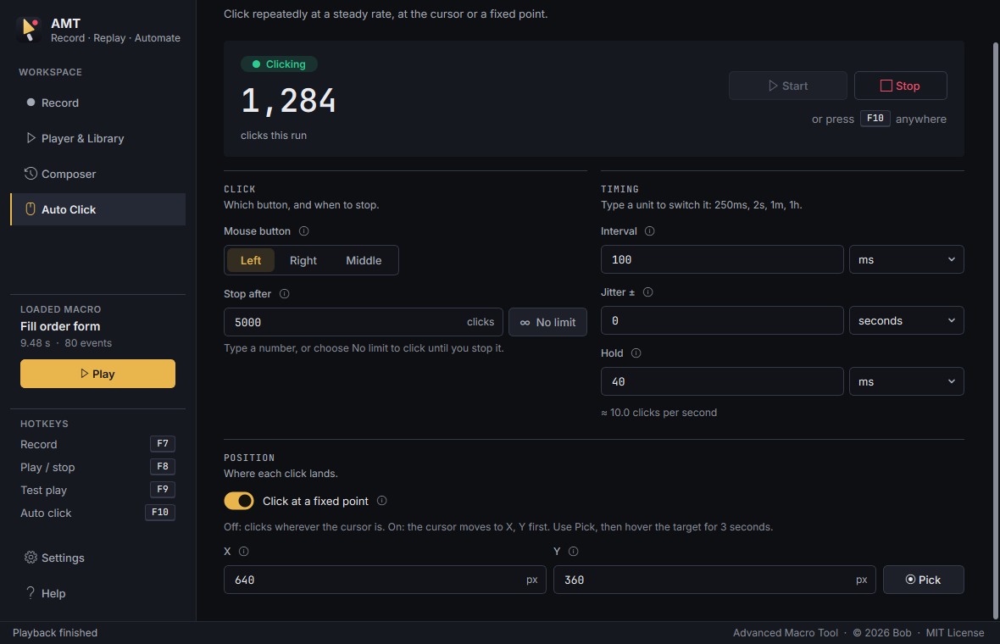
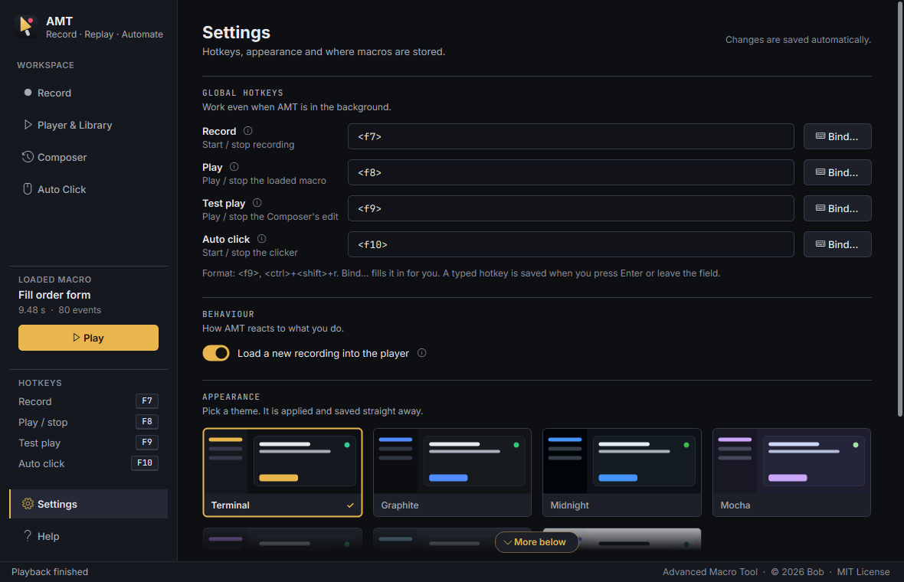
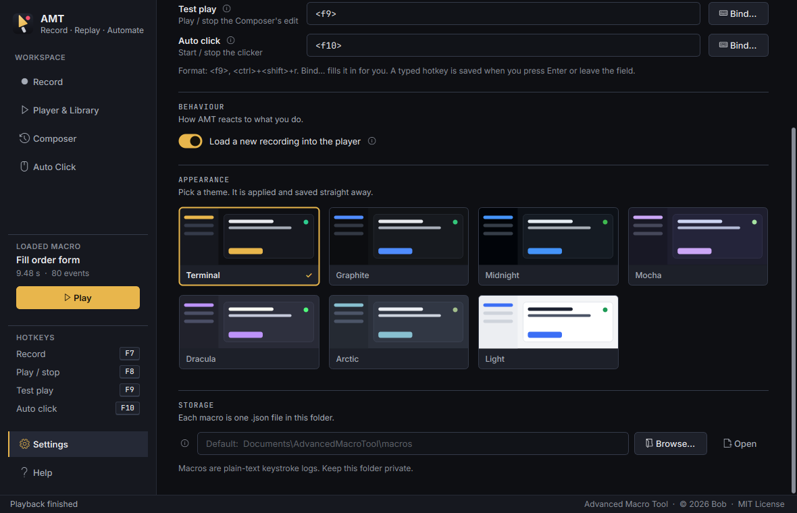

# AMT user guide

**AMT (Advanced Macro Tool)** records what you do with your mouse and keyboard
and plays it back for you: once, a hundred times, or until you tell it to stop.
It also has an Auto Clicker, and a Composer where you can edit macros on a
timeline or build new ones.

This guide walks through every part of the app and ends
with ideas for what you can use it for. You can read it inside AMT too: click
**Help** at the bottom of the sidebar.

If you are interested in how AMT works under the hood, that is in the
separate [technical documentation](TECHNICAL.md); you do not need it to use
the app.

**Contents**

- [What you can do with AMT](#what-you-can-do-with-amt)
- [A quick tour of the window](#a-quick-tour-of-the-window)
- [Typing numbers and times](#typing-numbers-and-times)
- [Your first macro in one minute](#your-first-macro-in-one-minute)
- [Record](#record)
- [Player & Library](#player--library)
- [Composer](#composer)
- [Auto Click](#auto-click)
- [Settings](#settings)
- [Ideas](#ideas)
- [Making macros that work every time](#making-macros-that-work-every-time)
- [What AMT does not do](#what-amt-does-not-do)
- [Safety and privacy](#safety-and-privacy)

---

## What you can do with AMT

| You want to… | Use |
|---|---|
| Repeat a task you do by hand, exactly as you did it | **Record**, then **Play** |
| Run it faster or slower, or many times in a row | **Playback** speed and loops |
| Make playback look less robotic | **Humanise movement** |
| Build a longer routine out of small recordings | **Composer** |
| Click the same spot (or wherever the cursor is) over and over | **Auto Click** |
| Start and stop all of this without switching windows | **Global hotkeys** (F7 to F10) |

---

## A quick tour of the window

- **Sidebar (left).** One entry per page. While something is running, its
  entry turns red, so you can see that a recording, playback or the clicker is
  active from any page.
- **Loaded macro.** The panel near the bottom of the sidebar shows which
  macro is loaded, on every page. Its button plays or stops it, a thin bar
  shows progress while it plays, and clicking the panel opens the player.
- **Hotkeys panel.** Below it, your current global hotkeys.
- **Help.** The last entry in the sidebar opens this guide.
- **Status bar (bottom).** The last thing that happened, such as "Saved
  'Fill order form' (402 events, 4.00s)".
- **(i) icons.** Hover the small *i* next to a setting to see what it does.
- **"More below".** When a page has more options than fit in the window, a
  fade and a **More below** button appear at the bottom. Click it, or scroll,
  to see the rest. It disappears when you reach the end.

The window works at any size. Make it narrow and the sidebar shrinks to icons
(hover them for their names; the loaded macro becomes a single play button),
sections stack in one column, and Player & Library puts the player above the
library.

---

## Typing numbers and times

Every number field takes plain typing: click it, type, press **Enter** (or
just click elsewhere). A comma works as well as a dot, so `1,5` and `1.5` are
the same. **Up** and **Down** nudge the value, as does the mouse wheel while
the field is selected. If what you typed is not a valid number, the field
turns red and goes back to the last good value when you leave it.

**Times** have a unit picker next to them (ms, seconds, minutes, hours, days;
each field offers only the units that fit its range).
You can pick the unit, or type it straight after the number and the picker
follows:

| Type | Becomes |
|---|---|
| `250ms` | 250 milliseconds |
| `2s` | 2 seconds |
| `1m` | 1 minute |
| `5h` | 5 hours |
| `1d` | 1 day |

Changing the unit keeps the number: `5` with *minutes* picked is five minutes.
When you press **Enter**, the number and the picker always end up agreeing.
A value outside the field's range is set to the nearest allowed value, and a
short note shows the range (for example, click jitter goes up to 10 seconds,
so `1m` becomes 10 seconds).

**Counts with no limit** (loops, the click limit) have a **∞ No limit** or
**∞ Forever** button next to them. Typing `0` switches it on too; press it
again to go back to your number.

---

## Your first macro in one minute

1. Press **F7**. The Record page shows **Recording** and starts counting.
2. Do the task: click, type, scroll.
3. Press **F7** again. The macro is saved as `Untitled-1`.
4. The new macro is loaded straight away: its name appears in the sidebar's
   *Loaded macro* panel and it is selected in **Player & Library**.
5. Press **F8** (or **Play**, in the page or the sidebar). AMT repeats what
   you did.

Press **F8** again at any time to stop playback. Any key or mouse button
that was held down is released, so nothing is left stuck.

---

## Record

The Record page turns your mouse and keyboard activity into a macro.

**To record:**

1. Optionally give it a **name**. If you leave it empty, AMT picks the next
   free `Untitled-N`. A name that is already used gets ` (2)` added, so an
   existing macro is never replaced.
2. Press **Start recording** or your record hotkey (**F7** by default).
3. Do the task.
4. Press **Stop recording** or the hotkey again. The macro is saved straight
   into your library and loaded into the player, so the play hotkey (**F8**)
   plays it right away. (Settings → *Behaviour* turns that off if you would
   rather keep the macro you had loaded.)

While recording, the page shows how many events have been captured and how
long the recording has been running.

**Keyboard shortcuts and held keys** are recorded exactly. Ctrl+C, Ctrl+V,
Ctrl+S and the like replay as the same key combinations. Holding a key down
is recorded as a hold, not a tap: playback keeps it down for as long as you
did, including the repeats Windows sends while a key is held (so holding a
letter in a text box types it repeatedly, just as it did for you).

**Record mouse movement.** On by default. Turn it off to keep only clicks,
scrolls and key presses. Recordings get much smaller, and playback jumps
straight from one click position to the next. If you turn on **Humanise
movement** when playing it back, AMT draws smooth paths between the clicks
for you.

> **Tip:** use the hotkey rather than the button to start and stop. Then the
> click on the button is not part of your recording.

---

## Player & Library

### The player

The player sits on the left. Its top part shows the loaded macro: its length,
event count, and a breakdown of mouse moves, clicks, scrolls and key presses.
Below that are the progress bar and the **Play** and **Stop** buttons.
**Unload** empties the player.

### The library

On the right: every saved macro, with the date it was recorded.

- **Click** a macro to load it into the player. **Double-click** to load it
  and start playing.
- **Filter** with the search box at the top.
- After **Unload**, click the macro again to load it back.
- **Import…** adds macro files (`.json`) to your library, for example ones
  you exported earlier or on another PC. You can also drag the files from
  Explorer onto the list. Imported macros never replace one you already
  have: a name that is taken gets ` (2)`. Only import and play macros from
  people you trust (see [Safety and privacy](#safety-and-privacy)).
- **Rename**, **Export** (save a copy anywhere as `.json`) and **Delete**
  are the icon buttons next to Import. The timeline button opens the macro
  in the Composer.
- With the list selected you can also press **Delete** or **Backspace** to
  delete the highlighted macro. AMT asks first, because a deleted macro
  cannot be brought back: press **Enter** to confirm or **Esc** to keep it.
  Afterwards the next macro is highlighted, so you can keep tidying up with
  the keyboard.

### Playback settings

These apply the next time you press Play.

| Setting | What it does |
|---|---|
| **Speed** | 0.1× to 10×. 2× plays twice as fast; 0.5× at half speed. |
| **Loops** | How many times to play it. **∞ Forever** (or typing 0) repeats until you stop it. |
| **Humanise movement** | Replaces the recorded mouse path with natural curves. See below. |

### Humanise movement

When it is on, AMT throws away the recorded mouse path and draws a new one
between each click and scroll:

- the cursor moves in a **gentle arc**, not a straight line;
- it **speeds up and slows down** like a real hand;
- the overall speed is taken **from your own recording**, so it feels like
  you;
- small random variations mean **no two runs are identical**.

Four controls fine-tune it. You can set them at any time; they are used
only while Humanise movement is on.

| Control | Effect | Good starting value |
|---|---|---|
| **Timing jitter** | Random variation in the gaps between actions | 5 % |
| **Curve arc** | How far the path bends away from a straight line | 25 % (0 = straight) |
| **Mouse noise** | Tiny pixel wobble along the path | 0 px (the default; try 1 to 2 px) |
| **Typing variation** | How much the time each key is held, and the pauses between keys, vary | 15 % |

**Typing** is humanised too: with Humanise on, how long each key is held and
the pauses between keys vary a little every run, like a person typing. The
keys and their order never change, so text and shortcuts such as Ctrl+C come
out exactly the same. Set Typing variation to 0 % to keep your recorded
rhythm exactly.

Clicks always land exactly where you recorded them. Only the path between
them changes.

---

## Composer

The Composer is a timeline editor. Open a recording to clean it up, or start
from nothing and build a macro out of other macros, waits, shortcuts and
text.

### Opening and saving

- **Open** a macro from the **Library** section (or double-click it). On
  **Player & Library** the timeline button next to a macro does the same.
- **New** starts an empty macro.
- **Save** writes your changes back to the macro you opened. If you changed
  the name first, Save keeps the original and saves a new macro instead.
- **Save as copy** always saves a new macro.
- **Test play** plays the edit once, at normal speed, without saving it.
  Its hotkey, **F9**, works from any page and from any other window, so you
  can switch to the program the macro is for, press F9 there, and watch the
  result. Press F9 again to stop.

Nothing is written until you save. If you open another macro or close AMT
with unsaved changes, AMT asks whether to save them.

### Reading the timeline

Time runs left to right. Each row is a kind of action:

| Track | Shows |
|---|---|
| **Keyboard** | Each key as a bar, as long as it was held. Keys held together (Ctrl under C) stack. |
| **Clicks & scroll** | Clicks (L, R, M) and bursts of scrolling. |
| **Mouse movement** | Stretches of cursor movement. |

Hover any action to see exactly what it is. The red line is the
**playhead**: inserting and pasting happen there.

### Selecting and editing

| To… | Do this |
|---|---|
| Place the playhead | Click the ruler or an empty spot |
| Select an action | Click it (**Ctrl**+click adds more) |
| Select a stretch of time | Drag across the timeline |
| Move actions | Drag them left or right |
| Move a stretch of time | Drag inside the selected stretch to the new spot; what follows moves along |
| Delete | **Del** or the trash button; deleting time closes the gap |
| Cut, copy, paste | **Ctrl+X**, **Ctrl+C**, **Ctrl+V** (pastes at the playhead) |
| Undo, redo | **Ctrl+Z**, **Ctrl+Y** |
| Zoom | **Ctrl**+mouse wheel, **+** and **-**, or the zoom buttons; **Fit** shows everything |

The shortcuts work anywhere on the Composer page, not only on the timeline.
The one exception is while you are typing in a text box: there, Ctrl+Z and
the others edit the text, as you would expect. A list of shortcuts is always
shown right under the timeline.

> **Zooming:** hold **Ctrl** and turn the mouse wheel over the timeline to zoom
> in and out around the pointer. Hold **Shift** and turn the wheel to scroll
> sideways.

The **Selection** section shows what is selected. For a single key or click you
can type an exact start time and how long it is held; for a click also its
screen position. Press **Apply changes**.

Edits keep the macro safe to play: a key is never left pressed. Cutting the
end off a held key releases it at the cut, and a key and its release always
move together.

Further down the page are the **Selection**, **Library**, **Optimise** and
**Insert at playhead** sections:

### Optimise

Works on the selected stretch of time, or on the whole macro when nothing is
selected:

- **Shorten pauses**: every pause longer than the first value becomes the
  second value, including idle time before the first action. A quick way to
  speed up a slow recording without changing how fast you typed.
- **Remove mouse movement**: keeps the clicks (which still land on their
  recorded spots) and drops the cursor paths. Turn on **Humanise** when
  playing to get natural paths back.

### Building and combining

**Insert at playhead** adds, at the playhead:

- **Wait**: a pause, from milliseconds to a week (type `500ms`, `2s`, `1m`).
- **Key combination**: a single press of a key or shortcut, for example
  `Ctrl+C`. Press **Bind…** and then the keys.
- **Text**: types the text character by character.

From the **Library** section, **Insert at playhead** adds a whole macro, as many
times as you set. You can also drag a macro from the list onto the timeline.

> **Why build from pieces?** Short recordings are easier to get right. Record
> "open the report", "export it" and "close it" separately, then put them
> together here with a wait in between. If one part changes, re-record just
> that part.

---

## Auto Click

A dedicated clicker, separate from macros.

| Setting | What it does |
|---|---|
| **Mouse button** | Left, Right or Middle |
| **Stop after** | Stop after this many clicks, or **∞ No limit** to click until you stop it. |
| **Interval** | Time from one click to the next, from 10 ms (100 clicks per second) up to a day. AMT shows the resulting clicks per second below it. |
| **Jitter ±** | Random variation added to each interval, so the rhythm is not perfectly regular. |
| **Hold** | How long the button stays pressed on each click. The hold is part of the interval: if it does not fit (a 40 ms hold with a 10 ms interval), the clicks come as fast as the hold allows, and the clicks-per-second line says so. For the fastest clicking, use a short hold (5 ms or less for 100 clicks per second). |
| **Click at a fixed point** | Off: clicks wherever the cursor is. On: moves to **X, Y** before every click. |

**To set a fixed point:** turn on **Click at a fixed point**, press **Pick**,
then hover the target. After 3 seconds AMT stores the cursor position.

Start and stop with the buttons or your auto click hotkey (**F10** by
default). The big counter shows how many clicks this run has made.

---

## Settings

### Global hotkeys

Hotkeys work everywhere, even when AMT is minimised or behind other windows.

| Action | Default |
|---|---|
| Start / stop recording | F7 |
| Play / stop the loaded macro | F8 |
| Play / stop the Composer's edit (Test play) | F9 |
| Start / stop the auto clicker | F10 |

The hotkeys follow the order of the pages in the sidebar, top to bottom:
Record, Player & Library, Composer and Auto Click on F7, F8, F9 and F10. That
range also stays clear of the F-keys browsers use most (F5 reloads, F6 jumps
to the address bar, F11 goes full screen, F12 opens developer tools).
A hotkey belongs to AMT: the program you are using does not see it. So F7
does not also switch on "caret browsing" in a browser, and F10 does not open
a program's menu bar. Only the exact key or combination you bound is kept:
with F7 bound, Ctrl+F7 still reaches the program as usual. That also means a
program that needs F7 for itself cannot have it while AMT is running; bind
AMT to another key if that gets in the way.

To change one, press **Bind…** next to it and press the key or combination
you want, for example `Ctrl` + `Shift` + `R`. Hotkeys are switched off while
the Bind window is open, so you can press a key that is already in use.
Choose keys that the program you automate does not use itself. A key that
types text (a letter, a number, Space, Enter) needs Ctrl, Alt or Win with it;
on its own it would stop working for typing. Settings will not save a
combination that is invalid or already used by another hotkey, and tells you
which one.

Hotkeys only react to keys you physically press, never to keys a macro
types, so playing a macro can't accidentally start a recording.

### Appearance

Pick a theme by clicking its preview. It applies, and is saved, instantly.

| Theme | Look |
|---|---|
| **Terminal** *(default)* | Near-black with a gold accent |
| **Graphite** | Neutral dark grey with a blue accent |
| **Midnight** | Deep navy with a bright blue accent |
| **Mocha** | Soft dark purple-grey with a lilac accent |
| **Dracula** | Classic purple and pink |
| **Arctic** | Cool blue-grey with an icy accent |
| **Light** | Clean white with a blue accent |

### Storage

Where your macros are saved. The default is `Documents\AdvancedMacroTool\macros`.
**Browse…** picks another folder and **Open** shows it in Explorer.

### Behaviour

**Load a new recording into the player** (on by default): when a recording
stops, it becomes the loaded macro, ready to play with F8. Turn it off to
keep the macro you had loaded.

### Saving

There is no Save button: every change in Settings applies and is saved
straight away. A hotkey you type in is saved when you press **Enter** or
click elsewhere. If a hotkey is not valid, or is already used by another
action, its field turns red and a line under the hotkeys says why; that one
hotkey keeps its previous value until you fix it, and everything else is
still saved.

---

## Ideas

AMT is a general-purpose tool. Some things people use macro recorders for:

- **Repetitive data entry.** Record filling in one form, then loop it. With
  the Composer, add a short wait between entries for a slow website.
- **Routine start-up.** Open the same apps, files and dashboards every
  morning with one key press.
- **Testing your own software.** Record a click-through of a screen you are
  building and replay it after every change, to check nothing broke.
- **Demos and presentations.** Record a walkthrough once and replay it
  smoothly, with **Humanise** on so it looks natural, at a speed that suits
  your audience.
- **Keeping a session alive.** A gentle macro or slow auto click on a loop
  stops a dashboard or remote session from timing out.
- **Accessibility.** Replace long runs of repetitive clicking with one
  hotkey.
- **Incremental and idle games.** The auto clicker was made for this. Check
  the game's rules first (see [Safety and privacy](#safety-and-privacy)).

---

## Making macros that work every time

A macro replays **exactly** what you did, at the same screen positions. It
cannot see the screen. These habits make that reliable:

- **Start from the same state.** Same window, same size, same scroll
  position as when you recorded.
- **Keep the same screen setup.** Positions are absolute. A different
  resolution, display scaling or monitor layout moves every target.
- **Prefer keyboard shortcuts** (`Ctrl+S`, `Tab`, `Enter`) over clicking
  small buttons. They do not depend on where things are on screen.
- **Leave room for slow programs.** If an app sometimes loads slowly, play at
  a lower speed or add a **Wait before** in the Composer.
- **Keep recordings short and compose them.** A short macro is easier to
  re-record when something changes.
- **Test once at low speed** before looping it many times.

---

## What AMT does not do

So you know what to expect:

- It does **not look at the screen**. No image or text recognition, no
  "click the button labelled Save wherever it is".
- It has **no conditions or variables**. A macro cannot decide what to do
  based on what happened; it replays the same steps every time.
- It works on **Windows** only.
- Hotkeys and playback do not reach windows running **as administrator**
  (for example Task Manager) unless AMT runs as administrator too.

---

## Safety and privacy

- **A recording is a keystroke log.** Everything you type while recording is
  saved in plain text, including a password if you type one. Stop recording
  before you log in to anything.
- **Only play macros you made yourself.** Playback types and clicks with your
  permissions. A macro file from someone else could do anything you could.
- **Nothing leaves your computer.** AMT has no network access, no account and
  no telemetry. Your macros are ordinary files in your macro folder.
- **Check the rules.** Automating input can break the terms of service of
  games, websites and workplace software. That decision is yours.

More detail: [Safety and privacy in the README](../README.md#safety-and-privacy)
and [SECURITY.md](../SECURITY.md).

---

Advanced Macro Tool · © 2026 Bob · Released under the [MIT License](../LICENSE)
